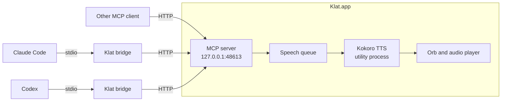

<div align="center">

# Klat

**A voice for your AI coding agents.**

Your agent finishes the work. You are in another window. Klat tells you, like a coworker at the next desk.

[](https://github.com/nandzz/klat/releases/latest)


```bash
brew install --cask nandzz/tap/klat
```

</div>

---

> *"Done. The login bug was a stale token in the cache. I fixed it and the tests pass. The diff is ready to review."*

You start a long task in Claude Code or Codex, and you switch to Slack, a browser or a meeting. Klat speaks when the agent finishes, when it needs a decision, or when it reaches a real milestone. It does not read the output aloud. It tells you what happened, what is important, and where to look.

## Why Klat

- **Local.** The voice is [Kokoro-82M](https://huggingface.co/hexgrad/Kokoro-82M), and it runs on your Mac. No cloud and no API key.
- **One voice for all your agents.** Every agent sends to one queue, so two agents never talk at the same time. You hear who speaks.
- **It speaks like a person.** The agent says one or two sentences, never code, paths or URLs. Klat also cleans the text: it removes Markdown and code, says "the file" for a path and "the link" for a URL, and reads "PR" as "P R".
- **Always in reach.** A small floating orb breathes while it waits and moves with the voice while it speaks. It shows the agent name and the current sentence.
- **Easy to connect.** One click sets up Claude Code and Codex. Any other MCP client can connect too.

## Get started

**1. Install**

```bash
brew install --cask nandzz/tap/klat
```

If Homebrew asks you to trust the tap, run `brew trust nandzz/tap` and install again. You can also download the zip from [Releases](https://github.com/nandzz/klat/releases/latest). The app is signed with a Developer ID certificate and notarized by Apple.

**2. Open Klat**

Klat lives in the menu bar. On the first start it downloads the voice model (about 100 MB). The orb shows a progress ring. When the ring is full, the voice is ready.

**3. Connect your agents**

Click the menu bar icon and choose **Install for Claude Code and Codex…**. Klat shows the exact changes and asks before it writes them.

**4. Start a new agent session**

Agents load MCP servers only when a session starts. Sessions that were open before the install do not have the voice.

To hear the voice without an agent, choose **Speak a test sentence** in the menu.

## When the agent speaks

The agent decides when to speak. The Klat skill and the MCP server instructions give it these rules:

| Kind | When | Example |
|---|---|---|
| `summary` | Before every final answer that has content, also a status or a report | *"The release is out. The cask needs the new checksum, see my answer."* |
| `progress` | At a real milestone of a long task, at most every minute or two | *"The build passes. Now I run the tests."* |
| `attention` | When it is blocked, needs a decision, or finds something urgent | *"I need your approval before I delete the old branch."* |

The agent skips the voice for a reply of one short sentence. If you mute Klat, the agent gets `muted: true` and continues in text.

## Controls

| Control | Action |
|---|---|
| Click the orb | Repeat the last sentence, repeat the last message, stop, mute |
| Drag the orb | Move it. Klat saves the position. |
| Right click the orb, or click the menu bar icon | All settings: voice, speed, volume, free memory when idle, show orb, start at login, install |
| `Control+Option+Command+S` | Stop speaking |
| `Control+Option+Command+M` | Mute or unmute |

There are 28 English voices (American and British, female and male) and 7 speeds from 0.8× to 1.5×.

Settings are in `~/Library/Application Support/Klat/settings.json`. You can change the port and the hotkeys there.

## Several agents at once

- One message plays at a time, in the order it arrives. `attention` messages go before queued `summary` and `progress` messages.
- A new message from an agent removes the queued `progress` messages of that agent, so you never hear old news.
- `interrupt: true` stops and clears the messages of the same agent only. It never cuts another agent.
- The orb shows the agent name from the MCP client, for example `claude-code`.

## How it works



- Each agent session starts a small **stdio bridge**. The bridge starts Klat if it does not run, and it connects again if Klat restarts. So a session does not lose the voice when the app was closed at session start.
- The **MCP server** listens on localhost only. It refuses requests that have a different Host header or any Origin header, so web pages cannot use it.
- **Kokoro** runs in a separate process. It makes the audio one sentence at a time, so the first sentence plays while the next one is made.

## MCP tools

| Tool | Input | What it does |
|---|---|---|
| `speak` | `text`, `kind` (`summary`, `progress`, `attention`), `interrupt` | Puts a message in the queue and returns at once. Returns `muted: true` when the user muted Klat. |
| `stop` | none | Stops the voice and clears the queue. |
| `status` | none | Muted, model state, speaking, queue length, current sentence, voice, speed. |

## Connect other clients

Use the stdio bridge in the MCP config of your client:

```json
{
  "command": "/Applications/Klat.app/Contents/MacOS/Klat",
  "args": ["/Applications/Klat.app/Contents/Resources/app.asar/dist/bridge/bridge.js"],
  "env": { "ELECTRON_RUN_AS_NODE": "1" }
}
```

Then copy [skill/klat/SKILL.md](skill/klat/SKILL.md) to the skills folder of your client. Without the skill, the agent still gets short rules from the MCP server instructions.

Claude Code, by hand:

```bash
claude mcp add --scope user klat -e ELECTRON_RUN_AS_NODE=1 -- /Applications/Klat.app/Contents/MacOS/Klat /Applications/Klat.app/Contents/Resources/app.asar/dist/bridge/bridge.js
```

You can also connect over Streamable HTTP to `http://127.0.0.1:48613/mcp`. But if Klat does not run when the session starts, the client marks the server as failed for the whole session. The bridge does not have this problem.

## Privacy

- The voice is made on your Mac. Klat sends no text and no audio to a server.
- The only network access is the voice model download from Hugging Face on the first start.
- The MCP server accepts connections from your Mac only.

## Resource use

Measured on an Apple Silicon Mac:

| State | CPU | Memory |
|---|---|---|
| Idle, voice model loaded | about 0.3% | about 940 MB |
| Idle, voice model unloaded | about 0.1% | about 510 MB |

- The voice model uses about 450 MB. **Free memory when idle** unloads it after 5, 10 (default) or 30 minutes without speech. The next message loads it again, which adds about 3 seconds before the first sound.
- The orb stops its animation 20 seconds after the voice stops.
- Klat releases the audio output 3 seconds after the last sentence.
- The voice uses the CPU for about one third of the duration of each sentence.

## Troubleshooting

| Problem | What to do |
|---|---|
| The agent does not speak | Start a new session. Agents load MCP servers only at session start. Check that the server is connected: `claude mcp list`. |
| The agent says "Voice not available" | Open Klat from Applications. The bridge could not start it. |
| The orb shows "Port 48613 is in use" | Another app uses the port. Change `port` in `settings.json`, quit and open Klat, and start a new agent session. The bridge reads the port from `settings.json`. |
| You hear nothing, but the agent calls `speak` | Klat is muted, or the volume is low. Check the menu bar icon. |
| The first sound takes a few seconds | The voice model was unloaded to save memory. Set **Free memory when idle** to **Never** to keep it loaded. |

## Uninstall

```bash
claude mcp remove --scope user klat
```

```bash
brew uninstall --zap --cask klat
```

`--zap` also removes the settings, the voice model and the skills. For Codex, remove the `[mcp_servers.klat]` block from `~/.codex/config.toml`.

## Development

You need Node.js 20 or later.

```bash
npm install
```

```bash
npm start
```

Run the tests (Vitest: text cleanup, speech queue, MCP server, Codex config writer):

```bash
npm test
```

Send a message to the running app from the terminal:

```bash
node scripts/say.mjs "Done. The tests pass. Have a look at the summary."
```

Build a signed `.app` in `dist-app/`:

```bash
npm run dist
```

### Release

`scripts/release.sh` runs the tests, builds the app, signs it, notarizes and staples it, and checks it with Gatekeeper. It needs a notarytool keychain profile. Make one with an App Store Connect API key:

```bash
xcrun notarytool store-credentials klat-notary --key <AuthKey_ID.p8> --key-id <key-id> --issuer <issuer-id>
```

Build and check only:

```bash
npm run release
```

Build, tag and publish the GitHub release:

```bash
npm run release -- --publish
```

The script prints the SHA-256 of the zip. Put the version and the SHA-256 in `Casks/klat.rb` of [nandzz/homebrew-tap](https://github.com/nandzz/homebrew-tap).

### Project layout

| Path | Content |
|---|---|
| `src/main/main.ts` | App start, menu bar, orb window, hotkeys |
| `src/main/mcp-server.ts` | MCP server (Streamable HTTP, localhost only) |
| `src/main/queue.ts` | Speech queue |
| `src/main/text.ts` | Text cleanup and sentence split |
| `src/main/tts.ts`, `src/main/tts-worker.ts` | Kokoro in a separate utility process |
| `src/main/installer.ts`, `src/main/toml.ts` | Setup for Claude Code and Codex |
| `src/bridge/bridge.ts` | stdio to HTTP bridge |
| `src/renderer/` | Orb and audio player |
| `skill/klat/` | The skill for agents |
| `scripts/release.sh` | Signed and notarized release |
| `test/` | Unit tests |

## Roadmap

- Speech input: hold the orb, speak, and send the text to the agent.
- Languages other than English.
- Intel, Windows and Linux builds.
